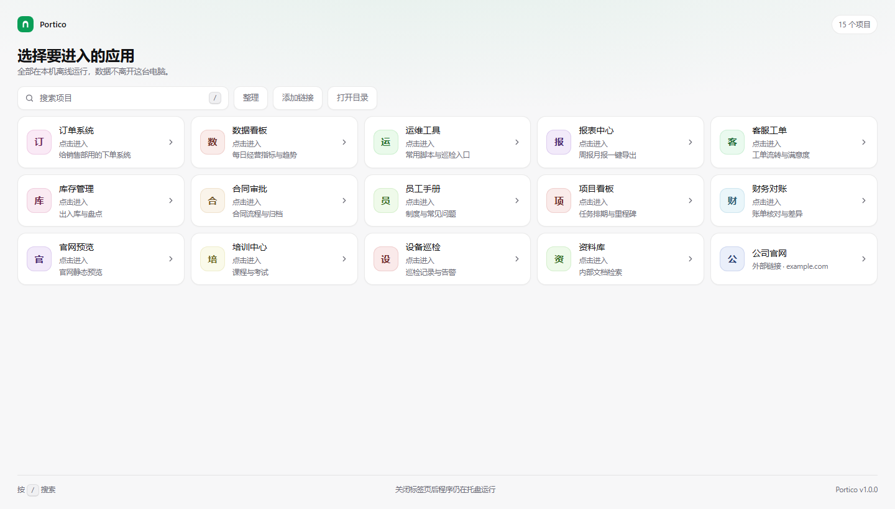

<div align="center">
  
  <h1>Portico · 应用坞</h1>
  <p>一个单文件的本地应用启动器：把静态前端和本地 exe 收进同一个页面，双击即用，目标电脑无需 Node.js。</p>
  <p>
    
    
    
  </p>
</div>



## 为什么做这个

把前端项目打包发给别人，麻烦的往往不是开发，而是对方电脑没有 Node.js，也不一定愿意装。

Portico 用 Go 编译成单个 exe，内置静态服务器和管理页面。目标机器不需要 Node.js、Nginx 或任何运行时，把项目目录放进去、双击程序就能用。

同时，越来越多的内部工具是 Go / Rust 编译出的单文件程序。Portico 也能识别并管理它们：启动、查看运行状态和 PID、停止整个进程树。

> **Portico** 意为「门廊、柱廊」——所有本地应用从这里进入。

## 特性

- **单文件分发**：一个 exe + 一个图标文件，约 10 MB，无外部依赖。
- **静态项目托管**：目录里有 `index.html` 即可，自动分配端口（18081–18100），支持 SPA history 路由回退。
- **程序型项目管理**：自动识别目录内的 exe，按进程名判断是否在运行，显示 PID，可停止进程树；程序自己双击启动也能被识别。
- **外部链接卡片**：不建目录，直接收藏常用网址；只跳转，不参与启停。
- **统一管理**：搜索、说明、置顶、上移/下移、自定义图标，所有展示配置集中在一个 `apps.json`。
- **托盘常驻**：查看运行中的应用并单独打开/停止，一键停止全部，打开日志，查看版本。
- **本地优先**：只监听 `127.0.0.1`，校验 Host 与 POST Origin，局域网无法访问。
- **省心细节**：关闭浏览器页面不影响服务、重复双击不会开第二份、日志超过 1 MB 自动轮转。

## 快速开始

### 直接使用

1. 准备一个可写目录，放入 `portico.exe`（图标与版本信息已编入，无需额外文件；不要放在 `C:\Program Files` 这类需要管理员权限的位置）。
2. 双击 `portico.exe`，浏览器会自动打开启动器页面。
3. 把前端 `dist` 里的内容放到 `apps/<项目名>/`，刷新页面即可看到卡片。

```
Portico/
├─ portico.exe
├─ apps/
│  ├─ 订单系统/
│  │  ├─ index.html
│  │  └─ assets/
│  └─ 报表中心/
│     └─ index.html
├─ apps.json      # 自动生成：显示名、说明、置顶、排序、链接
└─ app.log        # 自动生成：排错时看这里
```

完整的打包、交付与升级步骤见 [docs/使用手册.md](docs/使用手册.md)。

### 从源码构建

需要 Go 1.22 或更高版本：

```powershell
go build -trimpath -ldflags "-s -w -H windowsgui" -o portico.exe ./cmd/portico
```

- `-H windowsgui`：作为桌面程序运行，不弹黑色控制台窗口。
- `-s -w`：去掉调试信息，减小体积。
- 注入版本号：`-ldflags "-s -w -H windowsgui -X portico/internal/version.Version=1.0.0"`。

exe 的图标与版本信息由 `cmd/portico/rsrc_windows_*.syso` 提供（`go build` 会自动编入，已随源码提交）。修改 `assets/icon.ico` 或版本号后需重新生成：

```powershell
go install github.com/tc-hib/go-winres@latest
cd cmd/portico
go-winres simply --arch "amd64,386,arm64" --icon "..\..\assets\icon.ico" --manifest gui --product-name "Portico" --file-description "Portico Launcher" --original-filename "portico.exe" --file-version 1.0.0.0 --product-version 1.0.0.0
```

> 如需支持 Windows 7，需要使用 Go 1.20 工具链编译（Go 1.21 起官方不再支持 Win7/8）。

## 使用说明

### 静态前端

把 `dist` **里面的内容**放进 `apps/<项目名>/`，确保 `index.html` 在第一层：

```
✅ apps/订单系统/index.html
❌ apps/订单系统/dist/index.html
```

点击卡片会在新标签页打开项目，启动器页面保留，方便继续切换或停止应用。

### 单文件程序

目录内没有 `index.html`、但有可执行文件时，按程序型项目处理：

```
apps/运维工具/
├─ server.exe
└─ app.json      # 可选，仅用于指定启动参数
```

- 多个 exe 时优先选与目录同名的程序，并忽略 `Uninstall` 一类卸载程序；
- 仍无法确定时，用 `app.json` 的 `exe` 字段指定；
- 启动器只关心进程是否存活，**不注入端口、不探测 HTTP**，程序自己开窗口或界面即可。

### 外部链接

点击页面上的「添加链接」，填名称和地址即可，无需建目录。链接可置顶、排序、编辑和删除，数据保存在 `apps.json` 的 `link:` 前缀条目中。

### 卡片图标

在项目目录放 `icon.png`、`icon.ico`、`favicon.png`、`favicon.ico` 或 `logo.png` 之一即可；没有时显示名称首字母色块。

## 配置

### `apps.json`（启动器同目录）

所有展示信息集中在这里，无需改动各项目目录：

```json
{
  "订单系统": {
    "name": "订单系统",
    "note": "给销售部用的下单系统",
    "pin": true,
    "order": 10
  },
  "link:m1x2y3": {
    "name": "公司官网",
    "url": "https://example.com",
    "order": 20
  }
}
```

| 字段 | 说明 |
| --- | --- |
| `name` | 卡片显示名，不写则用目录名 |
| `note` | 卡片说明，悬浮显示完整内容 |
| `pin` | 置顶，置顶组始终排在最前 |
| `order` | 排序值，越小越靠前 |
| `url` | 有值表示这是一个外部链接卡片 |

### `app.json`（项目目录内，可选）

只放启动参数，展示相关的配置请写到 `apps.json`：

```json
{
  "exe": "server.exe",
  "args": ["--silent"],
  "env": { "APP_ENV": "prod" }
}
```

| 字段 | 说明 |
| --- | --- |
| `exe` | 自动识别失败时，指定用哪个 exe |
| `args` | 附加启动参数 |
| `env` | 额外环境变量 |

## 端口与托盘

| 端口 | 用途 |
| --- | --- |
| `18080` | 启动器页面，固定占用 |
| `18081`–`18100` | 静态项目使用，按首次点击顺序分配 |

- 卡片状态每 1.5 秒同步一次，关闭浏览器标签页不会释放端口；点卡片右侧的停止按钮即可释放。
- 右键托盘图标：打开 Portico、打开日志、运行中应用子菜单、停止全部应用、关于、退出。
- 左键单击托盘图标可重新打开启动器页面。

## 工作方式

1. 启动时扫描 `apps/` 下的每个目录，判断是静态项目、程序型项目，还是无法识别（卡片上直接标注原因）。
2. 静态项目在首次点击时按端口池顺序启动一个文件服务器，并做 SPA 回退；停止后端口立即释放。
3. 程序型项目按 exe 文件名扫描系统进程表判断存活，进程消失后卡片自动回到未启动。
4. 所有展示配置读写 exe 同目录的 `apps.json`，空条目自动清理。

## 项目结构

```
portico/
├─ cmd/portico/main.go          入口：目录、日志、HTTP 服务、托盘
├─ internal/
│  ├─ launcher/                 路由、页面、生命周期、静态托管、排序
│  │  └─ ui/launcher.html       启动器页面（编译进 exe）
│  ├─ project/                  项目扫描、apps.json、app.json
│  ├─ platform/                 浏览器、进程、托盘（Windows Win32）
│  └─ version/                  版本号
├─ assets/                      图标与 Logo 源文件（icon.ico 编入 exe 资源）
├─ docs/                        使用手册与截图
└─ apps/                        运行时项目目录
```

## 常见问题

**页面打不开或一直转圈？**
先看同目录的 `app.log`，常见原因是 `18080` 被其他程序占用，或被安全软件拦截了本地端口监听。

**关掉页面后端口还被占用？**
这是设计如此。端口由 `portico.exe` 持有，关闭标签页无法可靠通知服务端。点卡片上的停止按钮，或托盘里的「停止全部应用」。

**能放到共享盘给多人用吗？**
不建议。程序在自己所在目录读写，多台电脑同时启动容易冲突，建议每人一份。

**有 macOS / Linux 版本吗？**
静态托管逻辑是跨平台的，但托盘目前只有 Windows 实现（其他平台为占位），因此主要面向 Windows。

**如何确认对方用的是哪一版？**
页面底部和托盘「关于」中都会显示版本号。

## 参与贡献

欢迎提交 Issue 和 Pull Request。提交前请确保：

```powershell
go vet ./...
go test ./...
```

新增功能请同步更新 [docs/使用手册.md](docs/使用手册.md) 中受影响的章节。

## 许可证

[MIT](LICENSE) © 2026 Portico contributors
